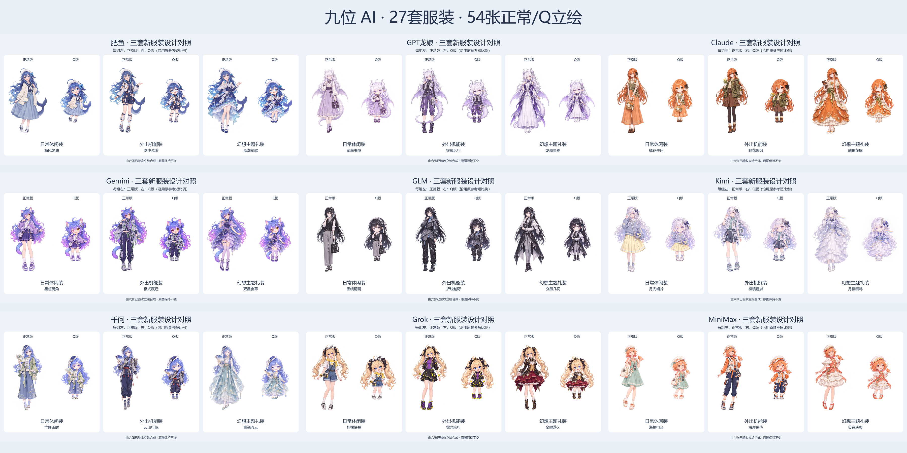

# AI角色与服装素材库

九位角色：肥鱼、GPT龙娘、Claude、Gemini、GLM、Kimi、千问、Grok、MiniMax。

每位有日常休闲装、外出机能装、幻想主题礼装三套设计，各自提供正常版和Q版，共27套、54张透明PNG立绘。

- [角色与服装目录](角色素材总览.md)
- [选图与使用说明](素材库使用说明.md)
- [机器可读索引](角色素材索引.json)
- [原始参考及来源说明](heybox-193355677-20261030/README.md)
- [生成与验收进度](生成与验收进度报告.md)

本目录共111张图片：54张当前服装立绘、18张按角色整理的原始参考、26张编号参考归档，以及13张总览、对照或历史图片。原始参考的18张副本与编号归档重合，保留它们以维持原目录结构。`Kimi/制作历史/`中的背景修复前版本及两张旧对照图仅作历史对照；当前选图以索引为准。

图片保留原字节、透明通道与生成来源元数据。公开索引移除了本机路径、会话编号及工具产物标识；原始本机档案保持不变。

## 来源与权利说明

新服装图由AI生成，使用既有角色参考保持身份，正常版与Q版分别制作。原始参考来自公开帖子及其中的转载图片；发布者不自动等于原作者。保留原归档的作者线索、公开来源及逐图许可待确认状态，不将这些素材统一改为MIT或其他许可，也不推定商用或再分发授权。

角色与服装素材的公开保存不改变原作品及角色的权利；具体来源与已知条件请阅读原始归档说明。
